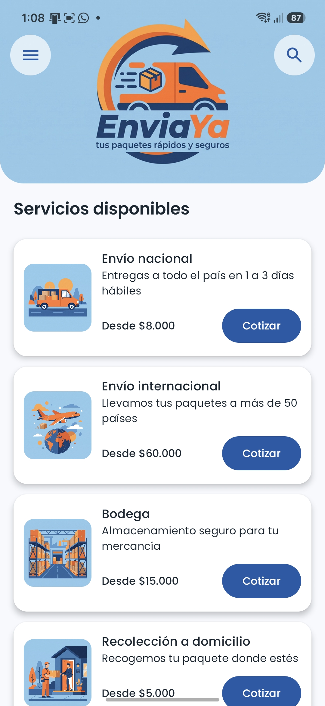
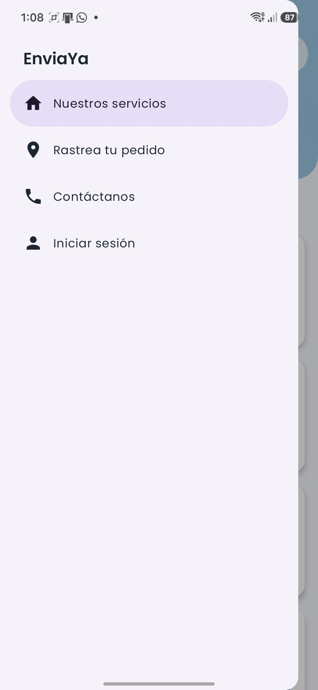
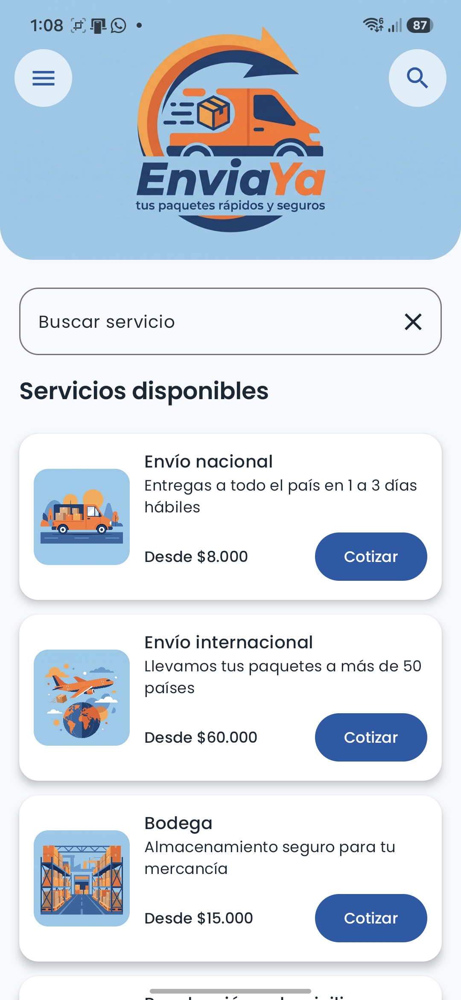
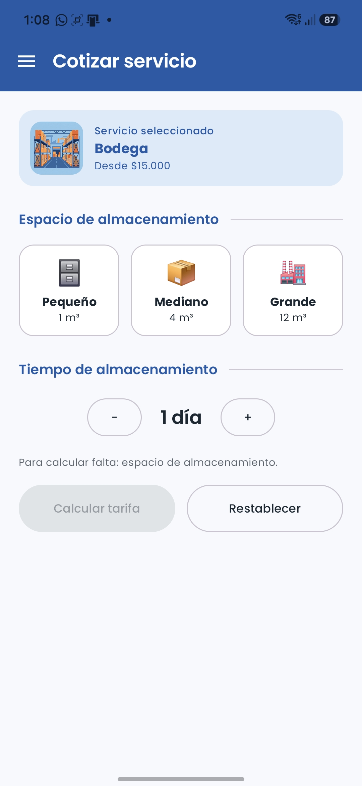
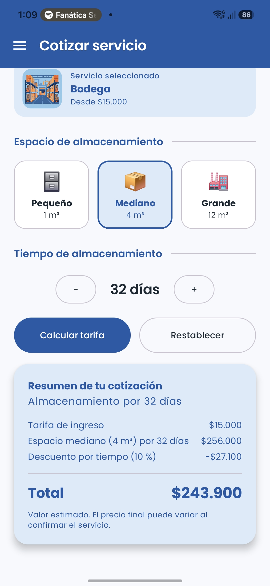
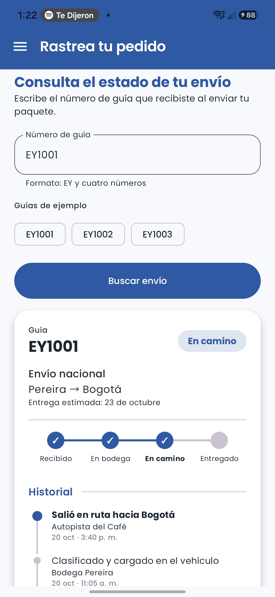
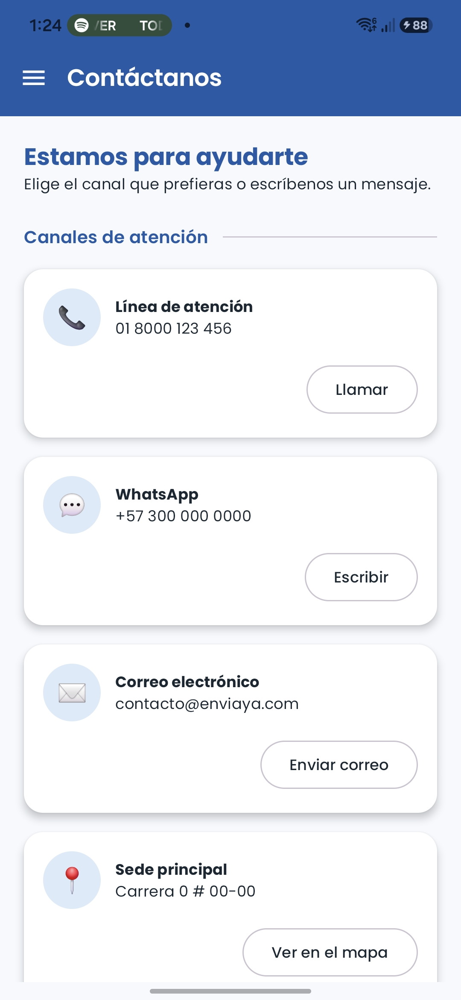
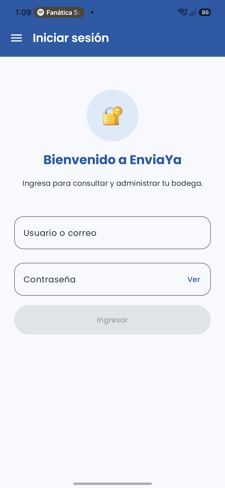
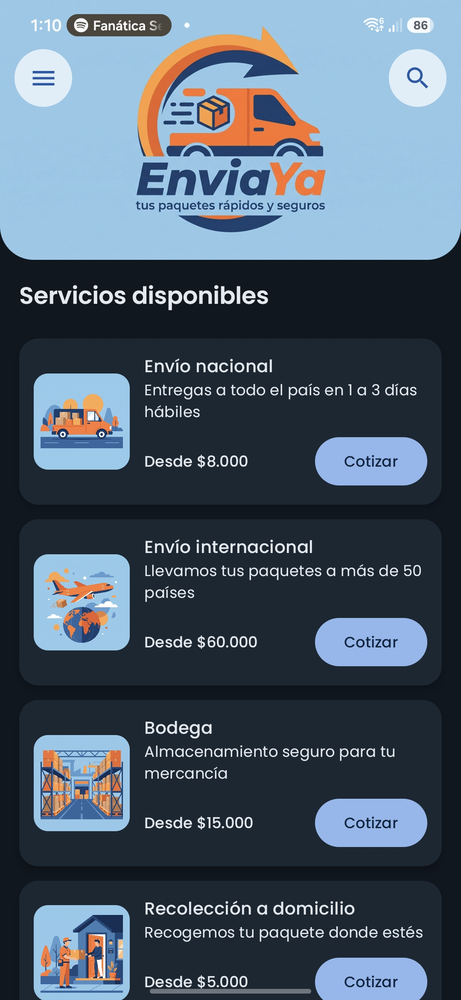

# 📦 EnviaYa — App móvil para una empresa de mensajería

Aplicación Android desarrollada con **Kotlin** y **Jetpack Compose** para la asignatura *Aplicativos Móviles*. Es la primera versión funcional de la app de **EnviaYa**, una empresa de mensajería y paquetería con servicios nacionales, internacionales, bodega y entregas especiales.

**Autor:** Lizeth Paola Zuluaga
**Asignatura:** Desarrollo de Aplicativos Móviles
**Repositorio:** https://github.com/lizzuluaga/EmpresaMensajeria
**Video demostrativo:** [Pega aquí el enlace del video]

---

## 1. El negocio

**EnviaYa** ofrece a personas y empresas el envío de paquetes con el lema *"Tus paquetes rápidos y seguros"*. Sus servicios son:

| Servicio | Descripción |
|---|---|
| Envío nacional | Entregas a todo el país en 1 a 3 días hábiles |
| Envío internacional | Paquetes a destinos en varios países |
| Bodega | Almacenamiento seguro para mercancía |
| Recolección a domicilio | Recogemos el paquete donde esté el cliente |
| Envío el mismo día | Entrega urgente dentro de la ciudad |
| Entrega especial | Cadena de frío y manejo cuidadoso para medicamentos y carga delicada |

## 2. Objetivo de la aplicación

Permitir que el cliente de EnviaYa **conozca los servicios, cotice su envío, rastree su pedido y contacte a la empresa** desde el celular, con una interfaz propia, clara y coherente con la identidad visual del negocio.

## 3. Pantallas implementadas

La app usa **Navigation Compose** (`NavController` y `NavHost`) con un **menú lateral** (Navigation Drawer) que se abre desde las tres rayitas del encabezado.

| Pantalla | Propósito |
|---|---|
| **Nuestros servicios** (principal) | Banner con el logo, buscador desplegable con la lupa y lista de servicios (`LazyColumn`). Al tocar un servicio se abre su cotización. |
| **Cotizar** | Formulario que se adapta al servicio elegido y calcula la tarifa con desglose. |
| **Rastrea tu pedido** | Búsqueda de una guía y estado del envío con barra de progreso y línea de tiempo. |
| **Contáctanos** | Canales de atención que abren otras apps, horario y formulario de mensaje. |
| **Iniciar sesión** | Pantalla de ingreso para la gestión de bodega (simulada). |

## 4. Las tres funcionalidades interactivas

### 🔎 Funcionalidad 1 — Búsqueda y filtrado de servicios *(trabajada en clase)*

Al tocar la lupa del encabezado aparece un campo de búsqueda que **filtra la lista de servicios en vivo** por título o descripción. Si no hay coincidencias muestra un aviso, y la **X** del campo borra el texto y cierra el buscador.

### 🧮 Funcionalidad 2 — Cotizador de envíos *(nueva)*

Al tocar un servicio se abre el cotizador, y **el formulario cambia según el tipo de servicio**:

| Modo | Servicios | Campos |
|---|---|---|
| Con destino | Envío nacional, Entrega especial | Ciudad de origen y destino (con botón para intercambiarlas), tamaño y peso del paquete, seguro, recolección. La entrega especial agrega el tipo de manejo (frío, delicado o supervisado). |
| Internacional | Envío internacional | Ciudad de origen, país de destino, tamaño y peso. |
| Local | Envío el mismo día, Recolección a domicilio | Una sola ciudad, tamaño y peso. |
| Bodega | Bodega | Espacio de almacenamiento y días (contador de más y menos). |

Características:

- **Validación en vivo**: destino distinto del origen, peso mayor que cero y que no supere el máximo del tamaño elegido.
- El botón **Calcular tarifa** permanece **desactivado** hasta que el formulario esté completo, y una nota indica qué falta.
- **Cálculo automático** con desglose: tarifa base, distancia (calculada con las coordenadas de las ciudades), peso, tamaño, manejo, recolección y seguro del 3 %. En bodega, descuento del 10 % desde 30 días y del 20 % desde 90 días.
- Si el usuario cambia un dato después de calcular, el resultado anterior desaparece.

### 📍 Funcionalidad 3 — Rastreo de pedidos *(nueva)*

El usuario escribe una guía (formato `EY` + 4 números) y la app la **busca en una colección** de envíos de ejemplo. El resultado cambia según el estado del paquete:

- Etiqueta de color: *Recibido, En bodega, En camino* o *Entregado*.
- **Barra de progreso** de cuatro pasos.
- **Línea de tiempo** con los movimientos del envío.
- Mensaje de error si la guía no existe.

Guías de ejemplo: `EY1001`, `EY1002`, `EY1003`, `EY1004` y `EY1005` (también hay botones de acceso rápido).

### Otras pantallas (extra)

- **Contáctanos**: los botones abren el marcador, WhatsApp, el correo y el mapa mediante *Intents*; incluye un formulario con validación (nombre, correo y mensaje) y una confirmación al enviar. El mensaje no se envía a ningún servidor.
- **Iniciar sesión**: formulario con contraseña oculta y botón *Ver*. Como todavía no existen usuarios registrados, cualquier dato muestra *"Usuario o contraseña inválidos"*.

## 5. Identidad visual y personalización

- **Nombre y logo** propios de EnviaYa (azul y naranja).
- **Tema Material 3** personalizado en `Color.kt`, `Theme.kt` y `Type.kt`, con **modo claro y oscuro** que sigue el del teléfono.
- **Tipografía Poppins** en toda la app.
- Ilustraciones propias para cada servicio, componentes con esquinas redondeadas y sombras suaves.
- Manejo del teclado (`imePadding`) y de las barras del sistema (*edge-to-edge*).

## 6. Conceptos de Jetpack Compose aplicados

- **Layouts**: `Column`, `Row`, `Box`, `Scaffold` y modificadores de tamaño, espacio y distribución.
- **Listas dinámicas**: `LazyColumn` con `items` generados desde una colección (no hay tarjetas escritas a mano).
- **Data classes** y colecciones: `Servicio` (6 elementos), `Ciudad`, `Pais`, `TamanoPaquete`, `OpcionManejo`, `EspacioBodega`, `Envio`, `MedioContacto`, entre otras.
- **Composables reutilizables**: `ProductCard`, `Encabezado`, `BarraSuperior`, `SeccionTitulo`, `SelectorDesplegable`, `TarjetaSeleccion`, `FilaInterruptor`, `TarjetaResultado`, `EtiquetaEstado`, `ProgresoEnvio`, `LineaTiempo` y `TarjetaContacto`.
- **Estado y eventos**: `remember` y `mutableStateOf`, elevación de estado (*state hoisting*), estado derivado (por ejemplo, el botón que se activa solo cuando no falta ningún campo) y `LaunchedEffect` / corrutinas.
- **Navegación**: `NavController`, `NavHost`, rutas con argumentos (`cotizar/{servicioId}`) y menú lateral (`ModalNavigationDrawer`).

## 7. Estructura del proyecto

```
com.example.empresamensajeria
├── MainActivity.kt
├── data/
│   ├── Servicio.kt        # servicios y modos de cotización
│   ├── Cotizacion.kt      # ciudades, países, tarifas y cálculo
│   ├── Envio.kt           # envíos de ejemplo y búsqueda de guías
│   └── Contacto.kt        # canales y horarios de atención
├── navigation/
│   ├── Rutas.kt
│   └── AppNavegacion.kt
└── ui/
    ├── components/        # componentes reutilizables
    ├── screens/           # una pantalla por archivo
    └── theme/             # Color.kt, Theme.kt, Type.kt
```

## 8. Capturas de pantalla

| Servicios | Menú lateral | Buscador |
|---|---|---|
|  |  |  |

| Cotizar | Resultado | Rastreo |
|---|---|---|
|  |  |  |

| Contáctanos | Iniciar sesión | Modo oscuro |
|---|---|---|
|  |  |  |

## 9. Cómo ejecutar el proyecto

**Requisitos**

- Android Studio (versión reciente) con el SDK de Android instalado.
- Un emulador o un teléfono Android con la depuración por USB activada.

**Pasos**

1. Clona el repositorio:
   ```bash
   git clone https://github.com/lizzuluaga/EmpresaMensajeria.git
   ```
2. Abre la carpeta del proyecto en Android Studio.
3. Espera a que termine la sincronización de Gradle (*Sync*).
4. Selecciona un emulador o tu dispositivo y pulsa **Run ▶**.

## 10. Alcance de esta versión

Siguiendo las indicaciones del proyecto, esta primera versión **no incluye** base de datos, conexión a API, autenticación real, persistencia de información, arquitectura MVVM ni ViewModel. Los servicios, ciudades, envíos y contactos son **datos locales de ejemplo** definidos en el proyecto, y están organizados para poder reemplazarse más adelante por una base de datos o un servicio en línea sin rehacer las pantallas.

## 11. Créditos

- Tipografía **Poppins** (Google Fonts, licencia SIL OFL).
- El logo y las ilustraciones de los servicios fueron generados con herramientas de inteligencia artificial (Gemini).
- Se usó asistencia de inteligencia artificial como apoyo en el desarrollo; el código fue revisado y probado por la autora del proyecto.
